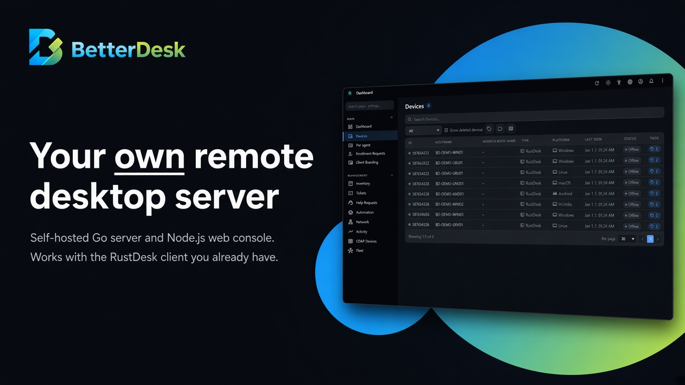
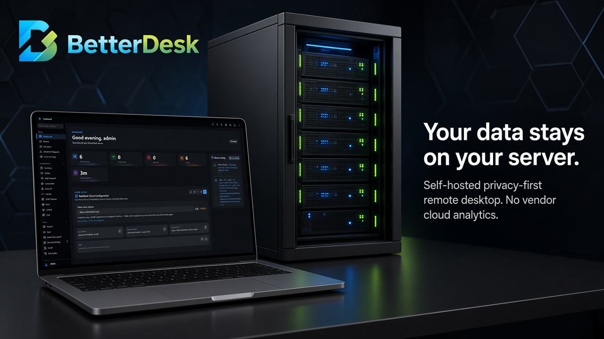
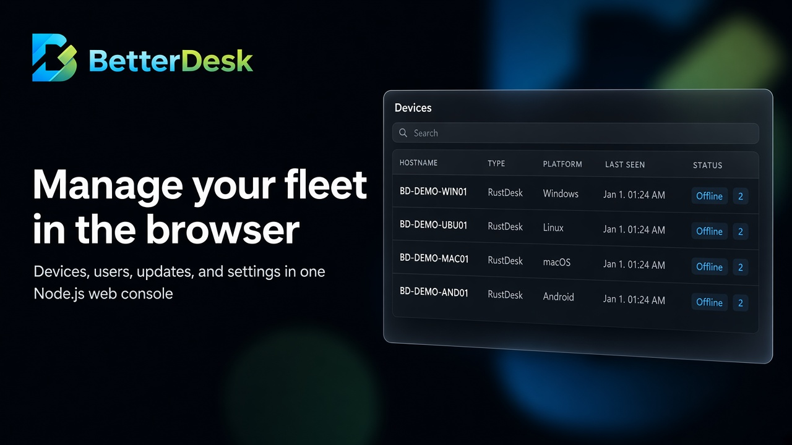
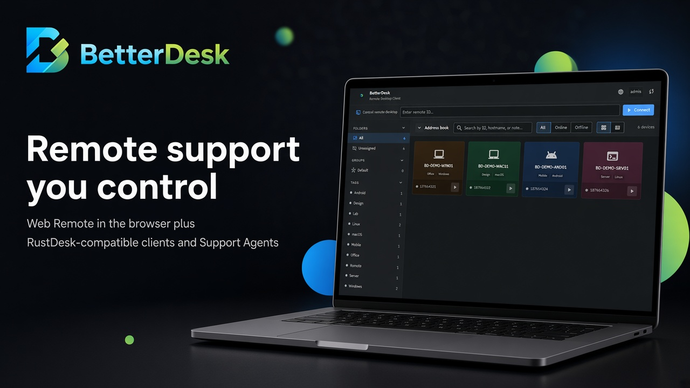
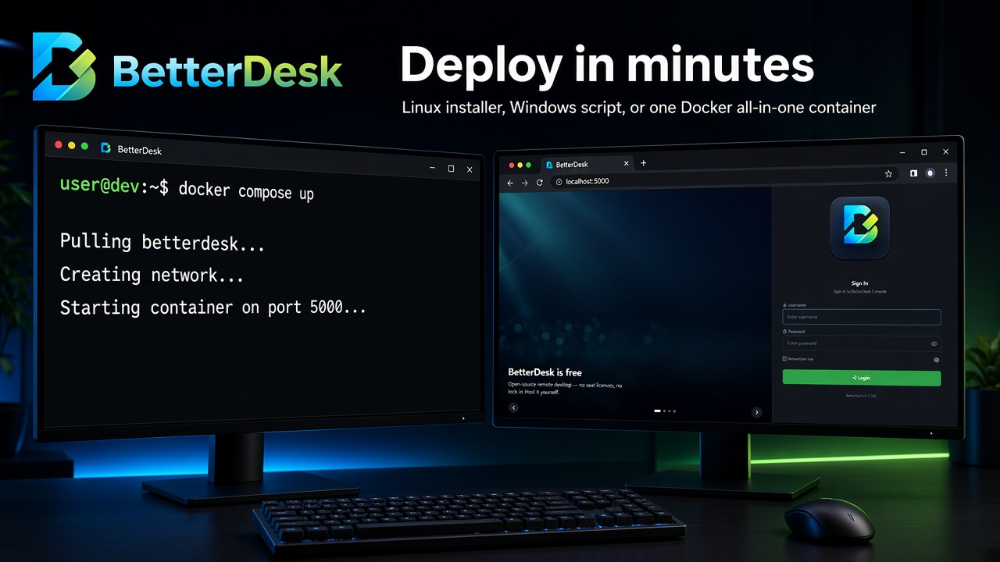
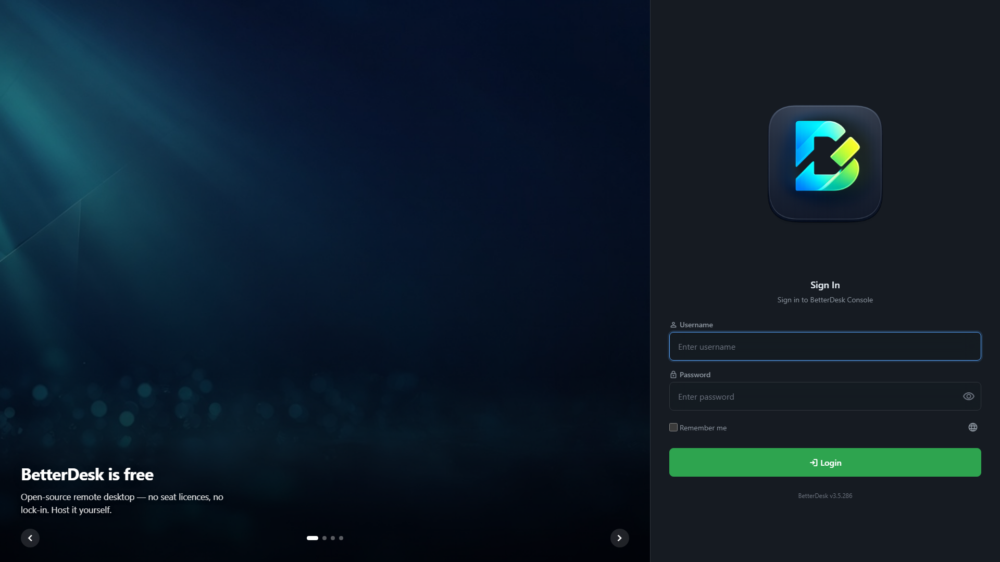
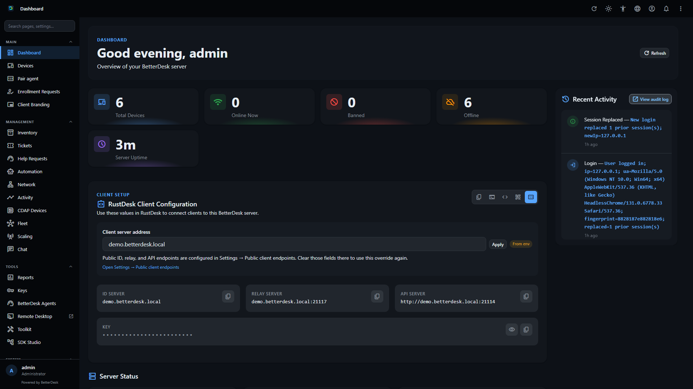
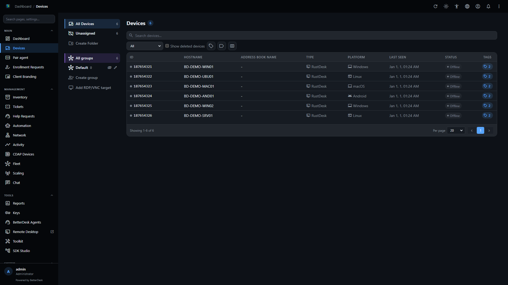
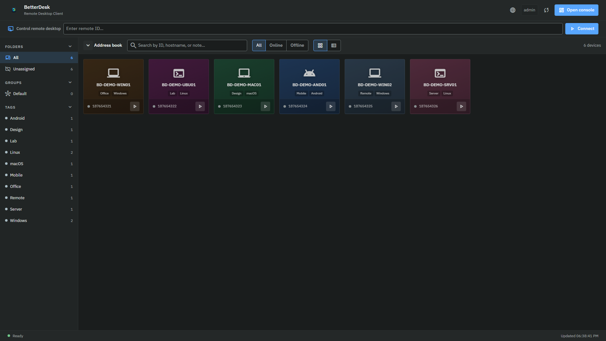
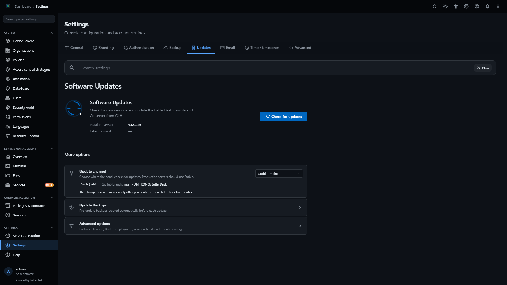

# BetterDesk

<div align="center">



<br>


[](https://github.com/sponsors/UNITRONIX)
[](https://buymeacoffee.com/unitronix)
[](https://discord.gg/MPp9hyyG97)

</div>

> **Official BetterDesk repository.** This is the original project by [@UNITRONIX](https://github.com/UNITRONIX):
> [`github.com/UNITRONIX/BetterDesk`](https://github.com/UNITRONIX/BetterDesk).
> Prefer this repo, its releases, and GHCR images (`ghcr.io/unitronix/betterdesk`).
> Other similarly named projects are not this product.

BetterDesk is a **self-hosted RustDesk-compatible server in Go** (one binary instead of `hbbs` + `hbbr`) **plus a Node.js web console** for devices, users, updates, and browser remote.

Your data stays on **your** server — the project does not run vendor analytics ([PRIVACY.md](PRIVACY.md)).

[Wiki](https://github.com/UNITRONIX/BetterDesk/wiki) · [Privacy](PRIVACY.md) · [Sponsors](SPONSORS.md) · [Changelog](CHANGELOG.md) · [Discord](https://discord.gg/MPp9hyyG97)

---

## Why BetterDesk

<table>
  <tr>
    <td width="50%">
      
      <p><strong>Self-hosted &amp; private</strong> — run the server yourself; no seat licences and no vendor cloud analytics.</p>
    </td>
    <td width="50%">
      
      <p><strong>Web console</strong> — manage devices, users, policies, and panel updates in the browser on port <code>:5000</code>.</p>
    </td>
  </tr>
  <tr>
    <td width="50%">
      
      <p><strong>Remote support you control</strong> — Web Remote in the browser, stock RustDesk clients, and Support Agents from BetterDesk-Client.</p>
    </td>
    <td width="50%">
      
      <p><strong>Deploy in minutes</strong> — Linux/Windows installers or one Docker all-in-one container.</p>
    </td>
  </tr>
</table>

More capability detail: [Web Console](https://github.com/UNITRONIX/BetterDesk/wiki/Web-Console) · [Web Remote](https://github.com/UNITRONIX/BetterDesk/wiki/Web-Remote) · [Client setup](https://github.com/UNITRONIX/BetterDesk/wiki/Client-Setup).

---

<div align="center">

### Honorary supporter

<a href="https://insolve.pl">
  
</a>

[INSOLVE](https://insolve.pl) — see [SPONSORS.md](SPONSORS.md) for everyone who backs the project.

### Bronze Sponsor

[betterde.sk](https://betterde.sk) ([@trybetterdesk](https://github.com/trybetterdesk))

</div>

---

> **Alpha desktop apps:** Tauri MGMT / Agent clients are not for production. Use the **web console** and a normal **RustDesk** client. Details: [Alpha notice](https://github.com/UNITRONIX/BetterDesk/wiki/Alpha-Software-Notice).

> **AI-assisted development:** BetterDesk is created and maintained with the assistance of artificial intelligence tools.

---

## Quick start

### Linux

```bash
git clone https://github.com/UNITRONIX/BetterDesk.git
cd BetterDesk
sudo ./betterdesk.sh
```

Choose **1** for a new install, or `sudo ./betterdesk.sh --auto`.

### Docker

One container with everything inside (server + relay + web console) — the recommended setup:

```bash
curl -fsSL https://raw.githubusercontent.com/UNITRONIX/BetterDesk/main/docker-compose.quick.single.yml -o docker-compose.yml
docker compose pull && docker compose up -d
docker compose exec betterdesk betterdesk-show-admin-credentials
```

Open **http://your-server:5000** (plain HTTP, not HTTPS).

Full Docker notes (including the legacy two-container layout): [Docker wiki](https://github.com/UNITRONIX/BetterDesk/wiki/Docker).

### Windows

Run `betterdesk.ps1` as Administrator — see the [Installation wiki](https://github.com/UNITRONIX/BetterDesk/wiki/Installation).

---

## Documentation

| Topic | Wiki |
|-------|------|
| Guides hub | **[GitHub Wiki](https://github.com/UNITRONIX/BetterDesk/wiki)** |
| Install / Docker / clients | [Installation](https://github.com/UNITRONIX/BetterDesk/wiki/Installation) · [Docker](https://github.com/UNITRONIX/BetterDesk/wiki/Docker) · [Client setup](https://github.com/UNITRONIX/BetterDesk/wiki/Client-Setup) |
| Config, TLS, updates | [Configuration](https://github.com/UNITRONIX/BetterDesk/wiki/Configuration) · [TLS](https://github.com/UNITRONIX/BetterDesk/wiki/TLS-SSL) · [Panel updates](https://github.com/UNITRONIX/BetterDesk/wiki/Panel-Updates) |
| Console & remote | [Web Console](https://github.com/UNITRONIX/BetterDesk/wiki/Web-Console) · [Web Remote](https://github.com/UNITRONIX/BetterDesk/wiki/Web-Remote) · [UX 3.5](https://github.com/UNITRONIX/BetterDesk/wiki/UX-3.5) |
| Ports & production components | [Home — Ports](https://github.com/UNITRONIX/BetterDesk/wiki#ports-short) · [What to run](https://github.com/UNITRONIX/BetterDesk/wiki#what-to-run-in-production) |
| Ops | [Monitoring](https://github.com/UNITRONIX/BetterDesk/wiki/Monitoring) · [Unattended & WoL](https://github.com/UNITRONIX/BetterDesk/wiki/Unattended-and-WoL) · [Troubleshooting](https://github.com/UNITRONIX/BetterDesk/wiki/Troubleshooting) · [FAQ](https://github.com/UNITRONIX/BetterDesk/wiki/FAQ) |
| Privacy / license | [PRIVACY.md](PRIVACY.md) · [Licensing](https://github.com/UNITRONIX/BetterDesk/wiki/Licensing) |
| Developers | [docs/](docs/) · [API](https://github.com/UNITRONIX/BetterDesk/wiki/API-Reference) · [CDAP](https://github.com/UNITRONIX/BetterDesk/wiki/CDAP) · [Contributing](docs/development/CONTRIBUTING.md) |

Wiki source in-repo: [`docs/wiki/`](docs/wiki/) (sync with `scripts/sync-wiki.ps1` / `.sh`).

---

## Web console preview

Current UX 3.5 dark theme (English, fictional demo devices):

<table>
  <tr>
    <td></td>
    <td></td>
  </tr>
  <tr>
    <td align="center">Login</td>
    <td align="center">Dashboard</td>
  </tr>
  <tr>
    <td></td>
    <td></td>
  </tr>
  <tr>
    <td align="center">Devices</td>
    <td align="center">Remote Desktop</td>
  </tr>
  <tr>
    <td colspan="2"></td>
  </tr>
  <tr>
    <td colspan="2" align="center">Settings → Updates</td>
  </tr>
</table>

Full tour: [Web Console wiki](https://github.com/UNITRONIX/BetterDesk/wiki/Web-Console).

---

## Contributing

Diagnostics → [issue](https://github.com/UNITRONIX/BetterDesk/issues) → fork / PR. See [docs/development/CONTRIBUTING.md](docs/development/CONTRIBUTING.md).

---

## Credits

### Console redesign — UX 3.6 inspiration

Parts of the current UX 3.5 Devices experience (list-first layout / rail) were inspired by the community redesign from
**[Linus Rath (@rathlinus)](https://github.com/rathlinus)**
([issue #493](https://github.com/UNITRONIX/BetterDesk/issues/493), [PR #495](https://github.com/UNITRONIX/BetterDesk/pull/495)).
The former UX 3.6 beta shell is retired — see [UX 3.5 wiki](https://github.com/UNITRONIX/BetterDesk/wiki/UX-3.5).

Design credit: [docs/development/CONTRIBUTOR-ATTRIBUTIONS.md](docs/development/CONTRIBUTOR-ATTRIBUTIONS.md).

---

## License

[AGPL-3.0](LICENSE). Optional Commercial Grant for eligible sponsors — [docs/COMMERCIAL-GRANT.md](docs/COMMERCIAL-GRANT.md).

---

## Support

- [Discord](https://discord.gg/MPp9hyyG97)
- [GitHub Issues](https://github.com/UNITRONIX/BetterDesk/issues)
- [Discussions](https://github.com/UNITRONIX/BetterDesk/discussions)
