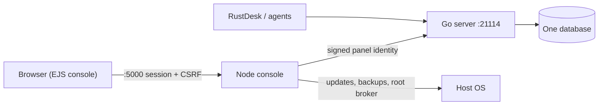

# Console backend strangler — moving the Node.js panel into the Go server

**Status:** planned (stage P0 — this document)
**Related:** [Discussion #496](https://github.com/UNITRONIX/BetterDesk/discussions/496), [issue #493](https://github.com/UNITRONIX/BetterDesk/issues/493), [PR #495](https://github.com/UNITRONIX/BetterDesk/pull/495), [betterdesk-go-centralization.md](./betterdesk-go-centralization.md), [betterdesk-api-port-consolidation.md](./betterdesk-api-port-consolidation.md), [sqlite-auth-consolidation.md](./sqlite-auth-consolidation.md), [betterdesk-update-flow.md](./betterdesk-update-flow.md)

## Status

| Stage | State | Where |
|---|---|---|
| P0 — inventory | **done** | this document |
| P1 — trust bridge | **done** | `betterdesk-server/api/panel_trust.go`, `panel_trust_test.go` |
| P2 — device groups / folders / ACL / grants | **done** | `betterdesk-server/db/panel_groups*.go`, `api/panel_groups_handlers.go`, `web-nodejs/services/panelGrouping.js` |
| P3 — users, roles, permissions catalog | **partly done** (catalog served by Go, panel loaded from it) | `betterdesk-server/api/panel_catalog.go`, `web-nodejs/lib/panelAccessCatalog.js` |
| P4 — branding | not started | — |
| P5 — support/operations domains | not started | — |
| P6 — UI serving model | not started, deliberately | — |

## Why

The community redesign asks for the console backend to move into the Go server:
no extra hop through Node, no second copy of the permissions, no Node.js needed
on the server.

Today the console is two processes:

```
browser ──HTTP/WS :5000──► Node console (Express, EJS, sessions, CSRF)
                              └──HTTP──► Go server :21114 / :21121 (API, DB, signal, relay)
```

Measured in this repository (2026-11):

| | Node console (`web-nodejs/`) | Go server (`betterdesk-server/`) |
|---|---|---|
| Route handlers | 692 in 50 files | 273 endpoints |
| Services | 63 files | api/, db/, auth/, cdap/, relay/ packages |
| Source | ~185 kLOC server JS + ~101 kLOC browser JS + 13 kLOC EJS | ~67 kLOC Go |
| Tables it owns | ~55 (`services/dbAdapter.js`, 360 KB, SQLite + PostgreSQL) | 48 |

The duplicated parts are real and named below. The parts that are Node-only
(session cookie, CSRF, EJS rendering, updater, privileged operations) are also
real, and nothing in this plan removes them before an equivalent exists.

## Non-negotiables

1. **One owner per data domain at any moment.** A domain is either Go-owned or
   Node-owned; never both writing.
2. **The panel must stay updatable by itself.** Every change here has to survive
   `POST /api/settings/updates/install` and `betterdesk.sh` / `betterdesk.ps1`
   (see [betterdesk-update-flow.md](./betterdesk-update-flow.md)).
3. **No big-bang.** Each stage ships alone, keeps the previous behaviour behind a
   flag, and can be rolled back without a new image.
4. **Day-to-day work lands on `dev`.** `main` only for a curated release.

## Where the duplication actually is

### Permissions

- Go owns permissions: `betterdesk-server/auth/permissions.go` (36 permissions),
  `db.RolePermission`, `role_permissions` table, `/api/roles/{role}/permissions`.
- Node already asks Go for the effective set (`services/rolePermissionService.js`,
  1 s cache) but keeps its own copies:
  - `lib/panelAccessCatalog.js` — 36 panel sections with read/write permissions;
  - `middleware/auth.js` — role map and `requirePermission`;
  - `services/userScopeService.js` — device scope per user.
- Net effect: two vocabularies that must be kept in step by hand. This is the
  first thing to unify, and it can be unified before any endpoint moves.

### Users

- `services/userSync.js` mirrors create/update/delete from the panel's store into
  the Go `users` table, with a best-effort backfill in both directions.
- Passwords, TOTP and panel sessions live in the Node store; the Go login
  (`/api/auth/login`) exists in parallel and the panel already calls it
  (`services/authService.js`, `verifyTotpViaGo`, LDAP/OIDC checks).

### Device groups, folders, ACL

- Node writes them (`services/deviceGroupService.js`, `routes/folders.routes.js`,
  `devices.routes.js` group endpoints).
- Go reads them for the RustDesk client (`db/panel_sync.go` interface,
  `db/console_auth.go` read-only `auth.db`, `db/postgres_*` implementations,
  `GET /api/device-group/accessible`, `GET /api/peers/list`).
- So one write path feeds a second process's read path through the database.

### Branding

- `services/brandingService.js` (59 KB: profiles, uploads, fonts, theme palettes)
  versus `api/branding_handlers.go` (58 KB). Both can serve `/api/branding`.

### Panels that are already pure proxies

`meshcentral.routes.js`, `fleet.routes.js`, `guest.routes.js` call Go and shape
the response. They can move with no data question at all.

## Target shape



Node keeps: the browser session, CSRF, EJS rendering, i18n, the updater, backup
and restore, the privileged broker, agent generation, and the WebSocket proxies
for remote/terminal/files/CDAP/mesh. Everything else is a candidate to move.

## Stage P0 — this document, the inventory

Deliverable: this file. No production code.
The matrix below is the work list. "Owner now" is measured, not assumed.

| Domain | Owner now | Target | Data |
|---|---|---|---|
| Panel identity bridge | — (Node session only) | Go trusts a signed panel header | none |
| Device groups / folders / ACL / tags | Node writes, Go reads | Go | `device_groups`, `device_group_members`, `device_group_user_access`, `device_group_user_group_access`, `folders`, `device_folder_assignments`, `user_peer_grants` |
| Users / roles / permissions | Both | Go | `users`, `role_permissions`, plus panel section table (new) |
| Branding, appearance, fonts | Both | Go (files stay on disk) | `branding_config`, `branding_profiles` |
| Tickets, activity, automation, network, DataGuard | Node | Go | `tickets`, `ticket_comments`, `ticket_attachments`, `activity_sessions`, `activity_summaries`, `alert_rules`, `alert_history`, `remote_commands`, `network_targets`, `network_checks`, `dlp_policies`, `dlp_events` |
| Reports, saved reports | Node | Go | `saved_reports` |
| Tenants | Node (redirects to Organizations) | drop after Organizations parity | `tenants`, `tenant_devices`, `tenant_users` |
| Agent bundles / builds | Node (build workers) | Node (host work, not data) | `agent_bundles`, `agent_bundle_builds` |
| Panel access policies | Node | Go (needs the section table) | `panel_access_policies`, `client_feature_policies` |
| Sessions | Node | Node | `sessions` (Node store) |
| Updates, backups, privileged ops | Node | Node | `data/`, host units |

## Stage P1 — the trust bridge (prerequisite)

**Implemented** in `betterdesk-server/api/panel_trust.go`.

Goal: let Go authorize a request that came through the Node console, without Go
owning a browser session, so endpoints can move one at a time.

- Node signs `{user, role, org, exp, nonce}` with HMAC-SHA256 using
  `PANEL_TRUST_SECRET` from `.env` (appended, never overwritten — `lib/envMerge.js` /
  `buildEnvSubstitutions()`), and forwards it on panel-originated calls in the
  `X-BetterDesk-Panel` header.
- Go verifies signature, expiry (≤ 120 s, 30 s clock skew), replay (nonce cache)
  and that the statement was signed for this exact method and path.
- The claimed role is a hint only: when the account exists, the role in the
  database wins, so a demoted user cannot keep an old session's role. Device and
  pro roles are refused outright — they exist for other transports.
- Accepted only from loopback, or from hosts listed in
  `PANEL_TRUST_ALLOWED_HOSTS` (container networks). The browser never sees this
  credential.
- With no secret configured the bridge is off and behaviour is exactly what it
  was: JWT / API key only.
- Tests (`panel_trust_test.go`): missing header, missing secret, valid statement,
  wrong secret, tampered payload, expired, future-dated, overlong TTL,
  cross-endpoint replay, cross-method replay, nonce replay, peer allowlist, role
  escalation, and that a disabled bridge keeps the legacy 401.

Rollback: leave `PANEL_TRUST_SECRET` empty (or stop sending the header).

## Stage P2 — device groups, folders, ACL, tags

**Implemented.**

Why first: the data already lives in tables Go reads, so the change is mostly
removing a writer.

1. Go now creates the tables it previously only read (`device_group_members`,
   `device_group_user_access`, `device_group_user_group_access`,
   `user_group_members`, `folders`, `device_folder_assignments`,
   `user_peer_grants`) — `db/sqlite.go`. PostgreSQL already had them.
2. `db.PanelGroupStore` (`db/panel_groups.go`) is implemented by both engines
   (`panel_groups_sqlite.go`, `panel_groups_postgres.go`). Every write is
   transactional, so the RustDesk sync reader in the same process never sees a
   half-applied ACL.
3. Endpoints (`api/panel_groups_handlers.go`): device groups (list/create-update/
   delete), membership, ACL, folders (list/create/update/delete), device→folder
   assignment, per-user grants. Reads need `device.view` / `user.view`, writes
   `device.edit` / `user.edit`.
4. The console keeps its screens and response shapes. `services/panelGrouping.js`
   is the only place it talks to the new endpoints, and `BACKEND_PANEL_GROUPING=node`
   restores the old writer without a redeploy.
5. A 404/501/503 (older server binary) falls back to the console's writer; a
   400/403 is treated as final and never retried through the other writer, so a
   refusal cannot be bypassed.
6. Verified by `api/panel_groups_handlers_test.go` (lifecycle, invalid input,
   permission gate), `db/audit_groups_test.go` (upgrade path creates the new
   tables) and `tests/panelGrouping.test.js` (switch and fallback rules).

Rollback: `BACKEND_PANEL_GROUPING=node`. Data is unchanged either way — the
migration is additive and both writers use the same tables.

## Stage P3 — users, roles, permissions

**Partly done: the catalog is now Go's.**

Done now — the definition half of the duplication:

- `GET /api/panel/catalog` (`api/panel_catalog.go`) serves the panel section
  list (key, label, group, read/write permission), the group list, the whole
  permission vocabulary and the built-in role defaults. Every signed-in
  principal may read it, because every role renders its own navigation from it.
- `web-nodejs/lib/panelAccessCatalog.js` loads it at startup
  (`refreshPanelCatalog()`, 60 s TTL, last good copy kept on failure) and looks
  sections up through `panelCatalog()`. The bundled list stays only as the
  fallback for an older server binary and for unit tests. This also removed a
  duplicate `toolkit` entry the console file had carried unnoticed.
- `tests/panelCatalogParity.test.js` compares the Go literal with the console
  file, so the two can no longer drift.
- `api/panel_catalog_test.go` proves the catalog is internally consistent
  (known permissions only, every group exists, no duplicate keys, pro role has
  nothing) and that the endpoint is behind auth.

Still open — the write half:

1. Panel user CRUD goes through Go; delete `services/userSync.js` and the local
   role map in `middleware/auth.js` (keep the helper names the views use).
2. Password material stays where the database is; do not re-hash or move hashes
   through the API.
3. Verify: login (password, TOTP, LDAP, OIDC), user CRUD, org membership, role
   overrides, panel access policies, and that a role change invalidates the
   Node permission cache.

Rollback for the catalog: the bundled list is used whenever Go cannot answer.

## Stage P4 — branding

Move profiles, uploads and font handling to Go; keep generated `branding.css`
served by the process that owns the stylesheet route, or generate it from Go
data. Operator custom colours (`themeMode: custom`) keep winning over the UX 3.6
palette — that rule is a product decision, not a rendering detail.

## Stage P5 — support and operations domains

Tickets, activity, automation/alert rules, network checks, DataGuard and saved
reports: additive table migration plus handlers, then delete the Node writers.
These have no client-facing API contract, so they are the cheapest remaining
moves after P2.

## Stage P6 — decide the UI serving model

Only after P2–P4: whether Go serves the console (EJS templates or a built SPA)
and whether the updater/privileged operations get a Go-side equivalent. This is
the point where "no Node.js on the server" becomes possible; it is explicitly out
of scope now.

## What must never move casually

| Area | Why | Files |
|---|---|---|
| Updater | Builds the Go binary from the selected SHA, merges `.env`, patches units, rolls back | `services/updateService.js`, `lib/privilegedUpdateHelper.js`, `lib/envMerge.js` |
| Backup / restore | Full DB copy semantics differ per engine | `services/backupService.js`, `services/scheduledBackupService.js` |
| Privileged broker | Fixed root-owned script, allowlisted operations | `scripts/linux-ensure-console-user.js`, `lib/privilegedPorts.js` |
| WebSocket proxies | Origin checks, session checks, loopback relay tricks | `services/wsRelay.js`, `bdRelay.js`, `chatRelay.js`, `remoteRelay.js`, `serverTerminalProxy.js` |
| Agent build workers | Host toolchains and artifact verification | `services/clientBuilderService.js`, `localClientBuilder.js`, `agentClientBuildWorker.js` |

## Verification per stage

- `cd betterdesk-server && go test ./...`
- `cd web-nodejs && npm test` (known pre-existing failures as of this branch:
  `tests/users.routes.test.js`, `tests/devices.routes.test.js`,
  `tests/dashboardPairingUi.test.js` — they fail on the baseline too)
- Panel smoke: login, devices, groups/folders, users, settings, updates preflight
- RustDesk client: login, address book, `device-group/accessible`, peers list
- Confirm the old table stops growing (no second writer)

## Open questions for the operator

1. Does the panel trust bridge secret live in the same `.env` for both processes
   (simplest — that is what is implemented), or in a separate file with tighter
   permissions?
2. Do we keep the Node session store as the only session, or does Go eventually
   own the browser session (needed only for P6)?
3. Is `tenants` kept as an alias after Organizations parity, or removed?

## How to turn the new pieces on

```bash
# 1. Generate the shared secret once, on the host.
node -e "console.log(require('crypto').randomBytes(32).toString('hex'))"

# 2. Add it to the panel's .env (the updater appends missing keys only).
PANEL_TRUST_SECRET=<the value>
# Container deployments where the panel is not on loopback:
PANEL_TRUST_ALLOWED_HOSTS=172.18.0.0/16

# 3. Grouping stays on Go by default; this is the rollback, not the opt-in.
BACKEND_PANEL_GROUPING=go
```

Verify: `curl -sf -H "X-API-Key: $(cat data/.api_key)" http://127.0.0.1:21114/api/panel/catalog | head -c 200`
answers with `"source":"go"`, and the console log shows
`[panel] authorization catalog loaded from Go`.
